 

Soy **Ivan Vallejo**, estudiante de la **Universidad Mariana** (Colombia).
Me gusta llevar una idea hasta el final: modelar los datos, escribir la API,
diseñar la interfaz y dejarla desplegada.

 

<h2 align="center">Proyectos destacados</h2>

**Heladería Antojos.** Sistema de operación completo para un negocio: cada área (admin, facturación, cocina, despachador, cajero y domiciliarios) tiene su propia pantalla, y todas trabajan sobre los mismos pedidos.

- Login único con roles, sesión JWT en cookie `httpOnly` y contraseñas con bcrypt.
- Notificaciones en tiempo real con Pusher y sincronización por deltas para gastar menos base de datos.
- Migración completa de Supabase a Neon con Drizzle ORM.
- Exportación de reportes y facturas a PDF, Excel y PNG.

🔒 *Repositorio privado.*

 

**Área 17.** Sistema de gestión empresarial con paneles para administrador y vendedor. Empezó como proyecto en Java con Tomcat y lo reconstruí como PWA instalable.

- Manejo atómico de stock en inventario, ventas y gastos.
- Códigos de barras, reportes en PDF y Excel, y estadísticas con Chart.js.
- Interfaz responsive con navegación propia para celular.

🔒 *La versión Next.js es privada.* [Ver la versión en Java →](https://github.com/IvanVallejo08888/proyectoinventario_v.1.0)

 

**Replay.** Tienda web de vinilos y cassettes hecha en equipo, con catálogo de scroll infinito, búsqueda con debounce y carrito de compras.

[Abrir la demo →](https://replay-silk.vercel.app) · [Ver el código →](https://github.com/IvanVallejo08888/Replay)

 

**MiSalud.** Aplicación web en Java para gestionar citas médicas, doctores y usuarios, con Servlets y arquitectura por capas.

[Ver el código →](https://github.com/IvanVallejo08888/MiSalud_AppFinal)

<h2 align="center">Más proyectos en Java</h2>

| Proyecto | Qué resuelve |
| --- | --- |
| [GestorDeAnimales](https://github.com/IvanVallejo08888/GestorDeAnimales) | Gestión de un bioparque con herencia: aves, mamíferos, reptiles, hábitats y control veterinario |
| [SistemaGestionAlumnos](https://github.com/IvanVallejo08888/SistemaGestionAlumnos) | Sistema por consola con persistencia en archivos planos, hecho en equipo |
| [Consignatariaproyecto1](https://github.com/IvanVallejo08888/Consignatariaproyecto1) | Gestión de vehículos para una consignataria |

<h2 align="center">Stack</h2>

<h2 align="center">Actividad</h2>

  

<!-- Contacto: agrega aquí tu LinkedIn o correo si quieres que te escriban. -->
